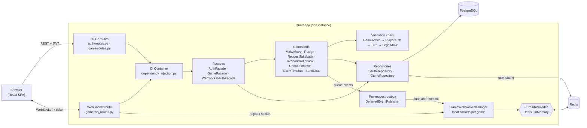
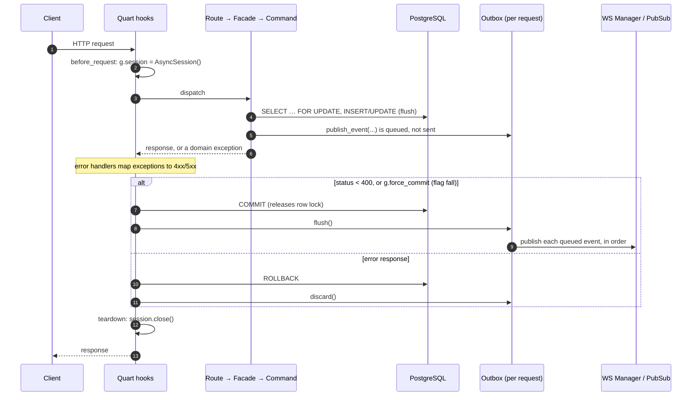
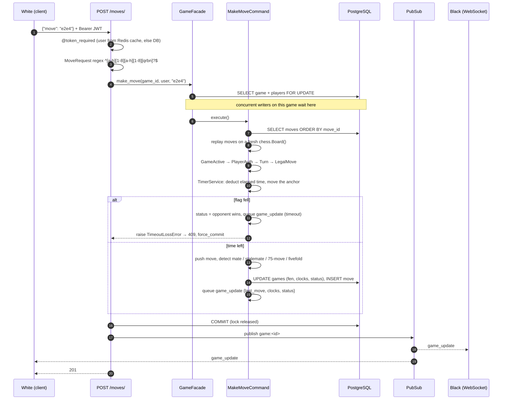
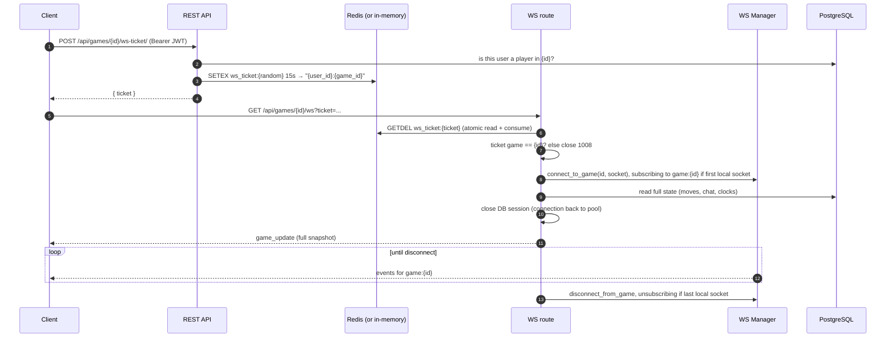
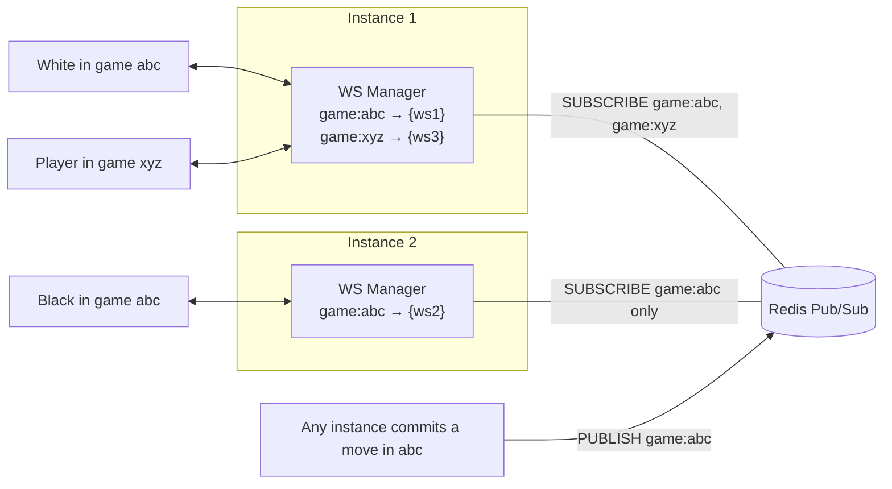
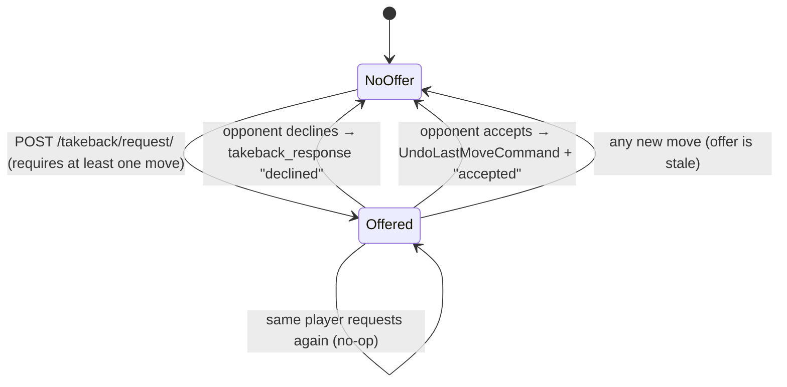
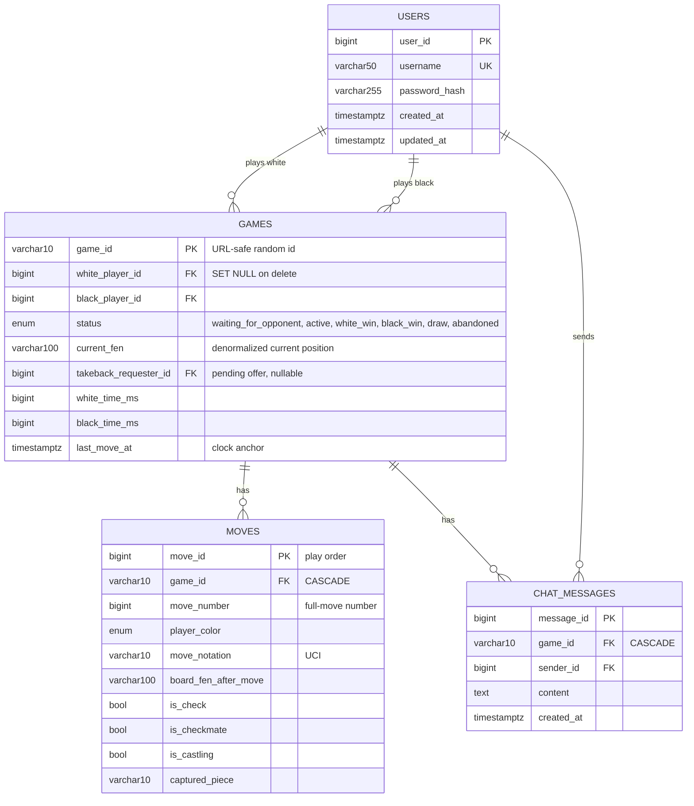
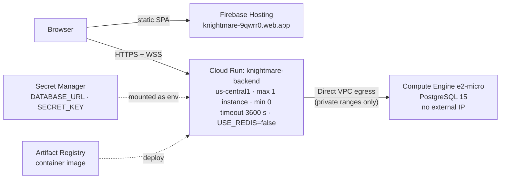

# Knightmare — Backend

Real-time multiplayer chess server: async Python (Quart), PostgreSQL, Redis Pub/Sub and WebSockets.
Two players get a shared board, server-authoritative chess clocks, in-game chat, takebacks and a peer-to-peer video call that this server signals.

**Live demo:** https://knightmare-9qwrr0.web.app  ·  **Frontend repo:** [knightmare-frontend](https://github.com/hardik-maheshwari/knightmare-frontend)

> The demo runs a single Cloud Run instance with in-memory Pub/Sub to stay inside the free tier. The multi-instance path (Redis Pub/Sub, shared tickets and cache) is the same code with `USE_REDIS=true`, and `docker compose up` runs it locally. See [Deployment](#deployment).

---

## Contents

- [Highlights](#highlights)
- [Tech stack](#tech-stack)
- [Architecture](#architecture)
- [Request lifecycle: one transaction per request](#request-lifecycle-one-transaction-per-request)
- [Making a move](#making-a-move)
- [Real-time delivery](#real-time-delivery)
- [Concurrency and consistency](#concurrency-and-consistency)
- [Chess clock](#chess-clock)
- [Takebacks](#takebacks)
- [Authentication](#authentication)
- [Data model](#data-model)
- [API reference](#api-reference)
- [Configuration](#configuration)
- [Running locally](#running-locally)
- [Testing](#testing)
- [Deployment](#deployment)
- [Known limitations](#known-limitations)
- [Project structure](#project-structure)

---

## Highlights

- **Horizontally scalable broadcasts.** Each instance subscribes to Redis only for the games its own sockets are watching (`game:<id>` channels), and fans messages out locally. The Pub/Sub backend sits behind an interface, so Redis and an in-memory provider are interchangeable.
- **Serialized game writes.** Every state-changing game action locks the game row (`SELECT … FOR UPDATE`) for the whole transaction. Two simultaneous moves, or two users joining the same game, can't both win.
- **Events only after commit.** Commands queue their broadcasts in a per-request outbox, which is published only after the transaction commits and discarded on rollback. Clients never see a move that didn't persist.
- **Board rebuilt from history.** Each move replays the game's moves (ordered by `move_id`) onto a fresh board, so python-chess can detect repetition draws. `games.current_fen` is kept as a denormalized copy for cheap broadcasts.
- **WebSocket auth without JWTs in URLs.** The JWT-protected API issues a single-use ticket. It's random, lives 15 seconds, is bound to one user and one game, and is consumed atomically with Redis `GETDEL`.
- **Read-through user cache.** Authenticated requests resolve the user from Redis (5-minute TTL) and fall back to Postgres on a miss.
- **Server-authoritative clocks.** Time is deducted on the server against a `last_move_at` anchor. When a flag falls, the move is rejected, but the game-over state is still committed.
- **Clean layering.** Routes → Facade → Command → Repository, with a small DI container, Chain of Responsibility for move validation, and a Bridge between the WebSocket manager and the Pub/Sub provider.

## Tech stack

| Concern | Choice |
|---|---|
| Web framework | [Quart](https://quart.palletsprojects.com/) (async Flask API) served by Hypercorn (ASGI) |
| Database | PostgreSQL via SQLAlchemy 2.0 async ORM + asyncpg, Alembic migrations |
| Cache / Pub/Sub / tickets | Redis (`redis.asyncio`); in-memory fallbacks for single-instance mode |
| Chess rules | [python-chess](https://python-chess.readthedocs.io/) |
| Auth | PyJWT (HS256), bcrypt (`quart-bcrypt`) |
| Validation | Pydantic v2 |
| Rate limiting | `quart-rate-limiter` (Redis or in-memory store) |
| Packaging | Docker; deployed on Google Cloud Run |

---

## Architecture



### Layers

| Layer | Responsibility | Example |
|---|---|---|
| **Routes** | Parse and validate input (Pydantic), call one facade method, shape the response. They don't catch domain errors; [`app/errors.py`](app/errors.py) maps exceptions to HTTP codes. | `POST /api/games/<id>/moves/` |
| **Facade** | Entry point per domain. Loads and locks the game, checks that the caller is a player, builds and runs a command. | `GameFacade.make_move` |
| **Command** | One game action (`IGameCommand.execute`): validate, mutate, persist, queue the broadcast. | `MakeMoveCommand` |
| **Rules** | Chain of Responsibility. Each handler checks one rule and either raises a domain error or passes to the next. | `TurnRule` |
| **Repository** | All SQL. Facades and commands never build queries. | `GameRepository.get_game_with_players(for_update=True)` |
| **Container** | Created per request. Builds repositories once and hands them to facades. HTTP requests also get the request's event outbox. | `get_container(session, outbox)` |

### Design patterns, and why each one is here

| Pattern | Where | Why |
|---|---|---|
| Facade | `app/game/facade.py`, `app/auth/auth_facade.py` | Routes stay thin, and the WebSocket route reuses the same game logic. |
| Command | `app/game/commands/` | Each action is one self-contained, testable unit. Accepting a takeback just runs `UndoLastMoveCommand`. |
| Chain of Responsibility | `app/game/rules/` | Move checks are ordered and independent; adding a rule means adding a handler. `LegalMoveRule` also stores the parsed move on the context so it's parsed only once. |
| Bridge | `app/managers/` ↔ `app/pubsub/` | Connection bookkeeping (manager) is separate from transport (provider). Redis ↔ in-memory is a config flag. |
| Adapter | `RedisPubSubProvider.listen()` | Converts Redis messages to a provider-neutral `{channel, data}` and drops subscribe confirmations. |
| Repository + DI container | `app/*/repository.py`, `app/dependency_injection.py` | One session per request, shared by every repository in it. |

---

## Request lifecycle: one transaction per request

Every HTTP request (except `/health`) gets one `AsyncSession`. Whether it commits is decided in one place, `finalize_db_session` in [`app/__init__.py`](app/__init__.py), based on the response status. The game events the request produced are published only after that commit.



- **Domain errors roll back.** A rejected join or an illegal move never leaves half-written state behind.
- **`g.force_commit`** is set by one handler: `TimeoutLossError`. The move is rejected with 409, but the flag-fall result (status and zeroed clock) must persist, and so must its broadcast.
- **A failed commit raises**, so Quart returns 500 and the outbox is never flushed.

---

## Making a move



The board is rebuilt by replaying the game's moves, not from the stored FEN. A FEN is only a snapshot with no move history, and python-chess needs that history to detect repetition. A game is at most a few hundred moves, so replay takes about a millisecond. If the replayed position ever differs from `games.current_fen`, the drift is logged and the move history wins.

---

## Real-time delivery

### Connecting a WebSocket

Browsers can't set an `Authorization` header on a WebSocket, and a JWT in a URL ends up in logs and proxies. So the client first trades its JWT for a **ticket**:



Two details in this flow:

- **Register before reading.** The socket joins the broadcast set *before* the snapshot is read, so an update that commits between the read and the registration can't be missed. At worst it arrives twice, and the client de-duplicates it.
- **No DB connection held per socket.** The session covers only auth and the first sync. Holding it for the whole connection would pin one pooled connection per open socket.

### Scaling across instances



- The two players of a game can be connected to different instances. Whichever instance handles the move publishes once; every instance with a local socket in that game receives it and fans it out.
- An instance **subscribes only to channels its own sockets need**. It subscribes on the first local socket of a game and unsubscribes when the last one leaves, so traffic per instance follows its own connections, not total games.
- The background listener is **gated by an `asyncio.Event`**. With no subscriptions it waits at zero CPU instead of polling. If the provider fails, it backs off 5 seconds and re-subscribes to every active channel.
- Dead sockets found during fan-out are removed. Sends to one game's sockets run concurrently (`asyncio.gather`).

### WebSocket events (server → client)

| `type` | When | Payload highlights |
|---|---|---|
| `game_update` | On connect and on join (full snapshot); after every move, undo, resignation or timeout (incremental) | `current_fen`, `turn`, `status`, `is_check`, `is_checkmate`, `is_draw`, `white_time_ms`, `black_time_ms`, `last_move_at`. A snapshot carries `moves` and `chat_history`; an incremental update carries `last_move`. Resignation and timeout add `game_over_reason`. |
| `takeback_offered` | A player requested a takeback | `requester_id`, `requester_username` |
| `takeback_response` | The opponent answered | `status`: `accepted` or `declined` |
| `chat_message` | New chat message | `message_id`, `sender_username`, `content`, `timestamp` |
| `signal_update` | WebRTC signaling relay (PeerJS peer IDs) | `sender_id`, `signal_type`, `payload`; never stored |

Clients only listen on the socket. All actions go through REST, so every write passes through the same auth, validation, transaction and outbox path.

---

## Concurrency and consistency

| Concern | Mechanism | Code |
|---|---|---|
| Two moves at once in the same game | Game row locked with `FOR UPDATE OF games`; the second request waits, then is validated against the committed result | `GameRepository.get_game_with_players(for_update=True)` |
| Which actions take the lock | join, move, resign, claim-timeout, takeback request/respond, undo | `app/game/facade.py` |
| Two users joining one open seat | Join takes the lock too; the loser sees `ACTIVE` and gets 409 | `GameFacade.join_game` |
| Move order | Moves ordered by `move_id`. A game's inserts are serialized by its row lock, so id order is play order. `created_at` isn't used, because Postgres `now()` is the transaction *start* time. | `GameRepository.get_moves_for_game` |
| Broadcast of rolled-back state | Per-request outbox, flushed after commit and discarded on rollback | `app/managers/publisher.py` |
| Ticket replay | `GETDEL` reads and deletes in one atomic step; tickets are bound to user and game and expire in 15 s | `WebSocketAuthFacade.validate_ticket` |
| Stale takeback offer | A new move clears `takeback_requester_id`, so accepting an old offer can't undo the wrong move | `MakeMoveCommand.execute` |
| Missed update while connecting | Register for broadcasts before reading the snapshot | `ws_routes.py` |

`tests/race_condition.py` fires two moves at once and expects exactly one to be accepted.

---

## Chess clock

- Format: 3+0 (three minutes each, no increment). Clocks start when the second player joins.
- The server stores each side's remaining time (`white_time_ms`, `black_time_ms`) and an anchor, `last_move_at`. On a move, the time since the anchor is deducted from the mover, and the anchor resets to now (`TimerService.apply_move_time`). The client clock is only a display.
- **Flag fall on move:** if the mover's time would reach zero or below, the move is rejected (`TimeoutLossError`, 409), the opponent wins, and `force_commit` keeps that result. It's also broadcast with `game_over_reason: "timeout"`.
- **Flag fall while idle:** a player who isn't moving never sends a request, so the client calls `POST /claim-timeout/` when its display reaches zero. The server recomputes from its own anchor and ends the game only if time really ran out, so calling it early does nothing.

---

## Takebacks



- The offer lives on the game row (`takeback_requester_id`). The requester can't answer their own offer, and a second player can't open a competing one.
- Undo deletes the last move, restores the previous position and restarts the clock for the side to move. Banked time isn't refunded.
- If the move being taken back **ended the game on the board** (checkmate or a draw), undoing it revives the game. A game that ended by **resignation or timeout** can't be revived.
- **God-mode undo** (`POST /undo/`) skips the handshake. It's a testing aid, disabled unless `ENABLE_GOD_MODE_UNDO=true`; otherwise it returns 404.

---

## Authentication

| | |
|---|---|
| Registration | Username 3–50 alphanumeric characters (unique), password up to 128 characters; bcrypt-hashed |
| Login | Returns an HS256 JWT `{user_id, iat, exp}` valid 24 h. **Rate-limited to 5 per minute** (shared via Redis when enabled). |
| HTTP auth | `@token_required` decodes the Bearer token, then loads the user with a **read-through cache**: Redis `user:<id>` (TTL 300 s), else Postgres plus a cache write. The cached object never includes the password hash. |
| WebSocket auth | Single-use ticket, see [Connecting a WebSocket](#connecting-a-websocket) |
| Authorization | Only the two players can get a ticket, move, chat, signal, resign or use takebacks (403 otherwise) |
| CORS | Allowed origins from `CORS_ALLOW_ORIGINS`. Auth is a header, not a cookie, so CSRF doesn't apply. |

---

## Data model



Schema changes are versioned with Alembic (`alembic/versions/`). The container runs `alembic upgrade head` on every start, and a failed migration stops the boot.

---

## API reference

All routes are under `/api`. Successful responses use `{"status": <code>, "data": ...}` and errors use `{"status": <code>, "error": "<message>"}`. The chat, signal and claim-timeout routes return a short `{"status": "..."}` body.

### Auth

| Method | Path | Auth | Description |
|---|---|---|---|
| POST | `/auth/register/` | – | `{username, password}` → 201 |
| POST | `/auth/login/` | – | `{username, password}` → `{token}` (5 per minute) |
| GET | `/auth/profile/` | JWT | `{user_id, username, member_since}` |

### Games

| Method | Path | Description |
|---|---|---|
| POST | `/games/` | Create a game; the creator plays White → 201 |
| POST | `/games/{id}/join/` | Join as Black; the game becomes `active` and clocks start |
| GET | `/games/{id}/` | Full snapshot (same shape as the WebSocket snapshot) |
| POST | `/games/{id}/ws-ticket/` | Single-use WebSocket ticket (players only) |
| POST | `/games/{id}/moves/` | `{move: "e2e4"}` in UCI, with optional promotion piece → 201 |
| POST | `/games/{id}/resign/` | Resign; the opponent wins |
| POST | `/games/{id}/claim-timeout/` | Ask the server to check the side-to-move's clock |
| POST | `/games/{id}/takeback/request/` | Offer a takeback |
| POST | `/games/{id}/takeback/respond/` | `{accepted: true\|false}` |
| POST | `/games/{id}/chat/` | `{content}`, 1–500 characters → 201 |
| POST | `/games/{id}/signal/` | `{type, payload}`, relayed to the game as `signal_update` |
| POST | `/games/{id}/undo/` | God-mode undo (404 unless `ENABLE_GOD_MODE_UNDO`) |
| WS | `/games/{id}/ws?ticket=…` | Event stream. Closes with 1008 (bad ticket) or 1011 (game not found). |
| GET | `/health` | Liveness; doesn't touch the database |

### Error mapping ([`app/errors.py`](app/errors.py))

| Exception | HTTP |
|---|---|
| Pydantic / `ValidationError` | 400 |
| `InvalidCredentialsError`, `UserNotFoundError`, bad or expired JWT | 401 |
| `UserNotPlayerError` | 403 |
| `GameNotFoundError` | 404 |
| `UsernameTakenError`, `GameNotJoinableError`, `AlreadyInGameError`, `MoveNotPossibleError` | 409 |
| `TimeoutLossError` | 409, and the state is still committed |
| Other `GameError` (e.g. resigning a finished game) | 400 |
| `RateLimitExceeded` | 429 |
| Anything else | 500, with a generic message |

---

## Configuration

Copy `.env.example` to `.env` for local runs.

| Variable | Default | Purpose |
|---|---|---|
| `SECRET_KEY` | **required** | Signs JWTs |
| `DATABASE_URL` | – | `postgres://`, `postgresql://` or `postgresql+asyncpg://`. libpq `sslmode` is translated for asyncpg. If unset, the URL is built from `DB_USER`/`DB_PASSWORD`/`DB_HOST`/`DB_PORT`/`DB_NAME`. |
| `USE_REDIS` | `false` | `false`: in-memory Pub/Sub, tickets, cache and rate limits, so **run exactly one process**. `true`: Redis-backed, required for more than one instance. |
| `REDIS_URL` | `RATELIMIT_STORAGE_URI` | Redis for Pub/Sub, tickets and the user cache |
| `RATELIMIT_STORAGE_URI` | `memory://` | Rate-limit store |
| `CORS_ALLOW_ORIGINS` | `*` | Comma-separated frontend origins |
| `ENABLE_GOD_MODE_UNDO` | `false` | Enables the consent-free `/undo/` testing route |
| `DEBUG` | `false` | Debug logging |
| `PORT` | `10000` (image) | Listen port; Cloud Run injects its own |

---

## Running locally

### Option A: Docker Compose (Postgres + Redis + API, multi-instance code path)

```bash
docker compose up --build        # API on http://localhost:8080
docker compose down -v           # stop and wipe the DB volume
```

### Option B: virtualenv

Requires Python 3.11 and a local Postgres. Redis is needed only if `USE_REDIS=true`.

```bash
python -m venv venv && source venv/bin/activate
pip install -r requirements.txt
cp .env.example .env             # set SECRET_KEY and DATABASE_URL
alembic upgrade head
python run.py                    # http://localhost:8080, auto-reload
```

Then run the [frontend](https://github.com/hardik-maheshwari/knightmare-frontend) with `npm run dev`. Its Vite dev server proxies `/api`, including WebSockets, to `localhost:8080`.

---

## Testing

`tests/` contains **integration scripts** that run against a live server on `localhost:8080`. They aren't a pytest suite yet.

| Script | Checks |
|---|---|
| `race_condition.py` | Two simultaneous moves: exactly one is accepted |
| `test_listener.py` | Scholar's mate, then a takeback handshake reverses the mate over WebSocket |
| `test_chat.py` | Chat is stored and broadcast, and appears in `chat_history` |
| `test_video.py` | WebRTC signal relay reaches the other player |
| `test_timer.py` | Server deducts thinking time from the mover |
| `lag_test.py` | Move-to-broadcast latency after the server has been idle (event-driven, not polling) |
| `scripts/http_test.sh` | curl flow: register, login, create/join, tickets, scholar's mate |

---

## Deployment



- **Why one instance:** with `USE_REDIS=false`, Pub/Sub, tickets and rate limits live in process memory, so `max-instances=1` is required. Turning on scaling means adding Redis (e.g. Memorystore), setting `USE_REDIS=true` and raising the instance cap. No code changes.
- **Database:** self-hosted Postgres on an Always Free VM with no public IP, reachable only over the VPC (SSH through IAP). In production I'd use Cloud SQL with private IP, HA and automated backups. Moving there only changes `DATABASE_URL`.
- **Secrets:** stored in Secret Manager, never in the image or the repo.
- **WebSockets** on Cloud Run are capped by the request timeout (1 hour). Scale-to-zero means the first request after idle pays a cold start.

### Redeploying (manual, no CI/CD yet)

```bash
./scripts/build.sh                                  # docker build + push, tagged with the git short SHA
gcloud run deploy knightmare-backend \
  --image=us-central1-docker.pkg.dev/knightmare-9qwrr0/knightmare-backend/knightmare-backend:<tag> \
  --region=us-central1
```

Pass only `--image`. Env vars, secrets and networking carry over from the previous revision, and re-sending `--set-env-vars` would replace them.

---

## Known limitations

- **One instance in the demo.** It's a cost choice. The Redis path exists and runs under Compose.
- **Events carry no sequence number.** Writes to one game are serialized, and a reply needs the previous move to be visible, so reordering would need one publish to be slower than the opponent's full round trip. A per-game version field would let clients drop stale events outright.
- **No JWT revocation or logout endpoint.** Tokens expire after 24 h.
- **Fixed rules:** 3+0 clock only, the creator always plays White, no draw offers. Repetition ends the game only at fivefold; threefold can't be claimed.
- **Undo doesn't refund clock time**, it only restarts the clock for the side to move.
- **Tests are scripts, not CI.** They need a running server, and there's no pipeline that runs them.

---

## Project structure

```
app/
├── __init__.py            # app factory: session per request, commit/rollback + outbox flush, blueprints
├── dependency_injection.py
├── errors.py              # exception → HTTP mapping
├── extensions.py          # async engine, Redis client / MockRedis, rate limiter
├── auth/                  # routes, AuthFacade, WebSocketAuthFacade (tickets), repository (+cache), JWT decorator
├── game/
│   ├── routes.py          # REST endpoints
│   ├── ws_routes.py       # WebSocket endpoint
│   ├── facade.py          # GameFacade
│   ├── commands/          # one class per game action
│   ├── rules/             # validation chain
│   ├── timer_service.py
│   ├── serializers.py     # WebSocket payloads
│   ├── repository.py
│   └── models.py
├── managers/              # GameWebSocketManager (Bridge abstraction), DeferredEventPublisher (outbox)
└── pubsub/                # PubSubProvider interface + Redis / in-memory providers
alembic/                   # migrations
config.py                  # env parsing, DB URL normalisation, CORS
entrypoint.sh              # migrate, then start Hypercorn
```

## License

MIT, see [LICENSE](LICENSE).
